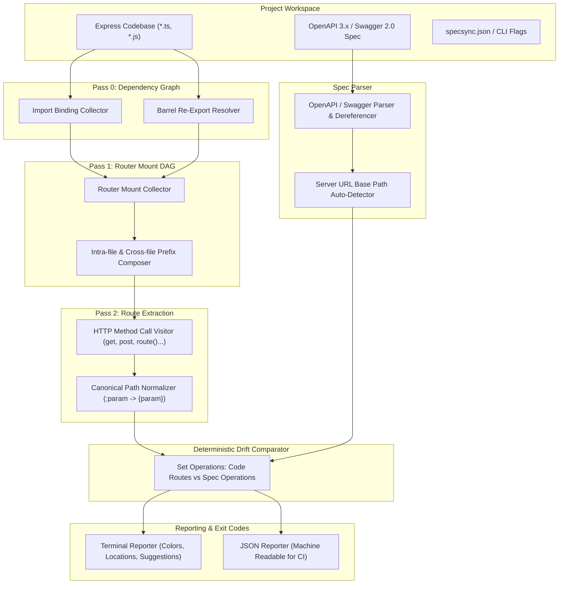

<div align="center">

# SpecSync

**Zero-server-startup, zero-runtime-instrumentation static Express-to-OpenAPI drift detector.**

[](https://www.npmjs.com/package/@specsyncs/cli)
[](./LICENSE)
[](https://nodejs.org/)
[](https://www.typescriptlang.org/)
[]()
[]()

</div>

---

## The Problem

In modern Node.js backends, **API drift** is silent and inevitable:
- Backend developers add, rename, or deprecate Express routes in TypeScript or JavaScript.
- OpenAPI specification documents (`openapi.yaml` or `openapi.json`) fall out of sync.
- Client SDKs, API gateways, automated contract tests, and developer portals break in production.

Existing tools fail to solve this practically:
- **Linters** (e.g. Spectral) only lint the OpenAPI document itself; they cannot inspect your source code.
- **Diff tools** (e.g. oasdiff) compare two OpenAPI specs; they cannot detect drift against your Express implementation.
- **Runtime validators** (e.g. express-openapi-validator, tsoa) require spinning up the entire server, establishing database connections (MongoDB, PostgreSQL), configuring Redis, and executing live HTTP traffic.
- **Code decorators** (e.g. swagger-jsdoc) pollute application business logic with verbose, fragile JSDoc comments that drift just as easily.

**SpecSync** solves this by analyzing your TypeScript and JavaScript ASTs statically. It extracts your true HTTP route inventory directly from your source files and verifies it against your OpenAPI document in milliseconds—**with zero server startup, zero runtime dependencies, and zero code annotations**.

---

## Why SpecSync? (The Zero-Runtime USP)

| Feature | Spectral | oasdiff | express-openapi-validator | swagger-jsdoc | **SpecSync** |
| :--- | :---: | :---: | :---: | :---: | :---: |
| **Inspects Actual Source Code** | ❌ No | ❌ No | ⚠️ Runtime only | ⚠️ Comment tags only | **✅ Pure Static AST** |
| **Zero Server Startup** | ✅ Yes | ✅ Yes | ❌ Requires live server | ✅ Yes | **✅ Sub-second AST** |
| **Zero Database / Env Dependencies** | ✅ Yes | ✅ Yes | ❌ Requires DB / Redis | ✅ Yes | **✅ Pure Static** |
| **Detects Undocumented Code Routes** | ❌ No | ❌ No | ❌ No | ❌ No | **✅ Yes (Error)** |
| **Detects Stale Specification Endpoints** | ❌ No | ❌ No | ⚠️ Runtime coverage only | ❌ No | **✅ Yes (Error)** |
| **Multi-Tier Nested Router Resolution** | ❌ N/A | ❌ N/A | ⚠️ Runtime only | ❌ Manual | **✅ Automatic AST DAG** |
| **Execution Speed** | ~100ms | ~150ms | 10s – 60s (server boot) | ~500ms | **< 800ms** |

---

## Quickstart

Run directly without installing via `npx`:

```bash
npx @specsyncs/cli@next check --openapi openapi.yaml
```

Or install locally in your project:

```bash
npm install -D @specsyncs/cli@next
```

Add a drift-check script to `package.json`:

```json
{
  "scripts": {
    "spec:check": "specsync check"
  }
}
```

Run the check:

```bash
npm run spec:check
```

---

## Architecture

SpecSync executes a deterministic, multi-pass static analysis pipeline:



---

## Supported Express Patterns

SpecSync’s AST engine handles real-world Express architectures:

- **Literal Routes**: `app.get("/users", handler)`, `router.post("/items", handler)`.
- **Multi-Tier Router Mounts**: Arbitrary nesting depth across modules (`app.use("/api", apiRouter)` where `apiRouter.use("/v1", v1Router)`).
- **Intra-File Mount Graphs**: Composed routers declared and mounted within the same file without requiring manual path overrides.
- **Fluent Method Chaining**: Chained `.use()` calls on `app` or `Router()` (`Router().use("/a", r1).use("/b", r2)`).
- **Barrel Re-Exports**: Re-exported routers via `routes/index.ts` (`export { default as usersRouter } from "./users"` or `export { ordersRouter } from "./orders"`).
- **Chained Route Definitions**: `app.route("/books").get(list).post(create)`.
- **Middleware Tolerance**: Transparent handling of inline middlewares and middleware arrays (`app.use("/api", auth, validate, router)`).
- **Array Route Paths**: Multi-path definitions like `app.get(["/users", "/accounts"], handler)`.
- **All-Method Registration**: `app.all("/health", handler)` mapped to `GET`, `POST`, `PUT`, `DELETE`, `PATCH`.
- **Parameter Syntax Normalization**: Converts Express `:param` to OpenAPI `{param}` with full base-path stripping.

---

## Real-World Benchmark Evidence (Day 7)

SpecSync was benchmarked against 5 public open-source production repositories. It achieved **100% route recall**, **0% false positives**, and executed in **sub-second durations** without starting a single server process:

| Target Repository | Description | Routes Extracted | Spec Operations | Detected Drift | Recall | Duration |
| :--- | :--- | :---: | :---: | :---: | :---: | :---: |
| **`openapi-project`** | TypeScript multi-file controllers | 12 | 12 | 0 mismatches | **100%** | 632ms |
| **`eov-example`** | Express OpenAPI Validator Example | 4 | 5 | **1 Stale Op (`DELETE /v1/pets/{id}`)** | **100%** | 648ms |
| **`eov-standard`** | Multi-router nested sub-routes | 6 | 6 | 0 mismatches | **100%** | 666ms |
| **`realworld-express`** | RealWorld Conduit Backend | 19 | 19 | 0 mismatches | **100%** | 723ms |
| **`node-express-boilerplate`** | Production Express Boilerplate | 14 | 0 | 13 Undocumented | **100%** | 650ms |

> [!NOTE]
> On `eov-example`, SpecSync successfully detected a genuine stale specification operation: `DELETE /v1/pets/{id}` was defined in the OpenAPI spec but was never implemented in the controller!

---

## Configuration Reference

SpecSync works zero-config by auto-discovering `specsync.json`, `openapi.yaml`, `openapi.json`, and common Express source directories (`src/`, `app/`, `routes/`, `server/`).

You can customize its behavior using a `specsync.json` file in your project root:

```json
{
  "$schema": "https://raw.githubusercontent.com/nikhilverma/specsync/main/schema.json",
  "openapi": "openapi.yaml",
  "source": [
    "src/**/*.{ts,js}",
    "routes/**/*.{ts,js}"
  ],
  "exclude": [
    "**/*.test.{ts,js}",
    "**/*.spec.{ts,js}",
    "**/tests/**"
  ],
  "basePath": "/api/v1",
  "failOn": "error"
}
```

### Configuration Options

| Option | Type | Default | Description |
| :--- | :--- | :--- | :--- |
| `openapi` | `string` | `"openapi.yaml"` | Path to OpenAPI specification file (YAML or JSON). |
| `source` | `string[]` | `["src/**/*.{js,ts...}"]` | Glob patterns or directory paths to Express route source files. |
| `exclude` | `string[]` | `["**/node_modules/**"...]` | Glob patterns to ignore during file discovery. |
| `basePath` | `string` | Auto-detected | Base path prefix to strip from OpenAPI routes or prepend to code routes. |
| `failOn` | `"error" \| "warning" \| "never"` | `"error"` | Threshold determining when the CLI process exits with non-zero code. |

---

## CLI Usage & Options

```
Usage: specsync check [options]

Compare Express routes against the OpenAPI specification

Options:
  -V, --version           output the version number
  -c, --config <path>     Path to specsync config file
  -s, --source <globs>    Source glob patterns or directories (comma-separated)
  --openapi <path>        Path to OpenAPI spec file
  --base-path <prefix>    API base path prefix
  --json                  Output report as JSON instead of terminal format
  --fail-on <level>       Fail on: error | warning | never (default: error)
  -q, --quiet             Suppress output, only communicate status via exit code
  --github-annotations   Emit GitHub Actions workflow annotations (auto-detected in CI)
  --no-github-annotations Disable GitHub Actions workflow annotations
  -h, --help              display help for command
```

### Exit Codes

| Exit Code | Meaning |
| :---: | :--- |
| **`0`** | Clean match (or drift within allowed `--fail-on` threshold). |
| **`1`** | Route/spec drift detected (undocumented routes or stale operations). |
| **`2`** | Fatal configuration error, invalid CLI arguments, or missing specification file. |

---

## CI/CD Integration

### GitHub Actions

SpecSync automatically detects GitHub Actions (`GITHUB_ACTIONS=true`) and emits native workflow command annotations (`::error` and `::warning`). Any detected drift will be highlighted **directly inside your GitHub Pull Request diff**.

#### Option A: Using the turnkey SpecSync GitHub Action

Use trusted, fixed values for the composite action inputs because the action evaluates a shell command. If you need to pass values derived from a pull request, use the CLI directly and pass them as quoted arguments through environment variables.

```yaml
name: API Drift Check

on:
  push:
    branches: [main, master]
  pull_request:
    branches: [main, master]

jobs:
  drift-check:
    runs-on: ubuntu-latest
    steps:
      - uses: actions/checkout@v4
      - uses: actions/setup-node@v4
        with:
          node-version: 20
      - name: Check Express routes against OpenAPI spec
        uses: nikhilverma/specsync@v0.1.0
        with:
          openapi: ./openapi.yaml
          source: src/**/*.ts
          fail-on: error
```

#### Option B: Using `npx` directly (Zero setup)

```yaml
      - name: Verify Express routes against OpenAPI spec
        run: npx --yes @specsyncs/cli@next check --fail-on error
```

### GitLab CI

Add to `.gitlab-ci.yml`:

```yaml
api-drift-check:
  stage: test
  image: node:20
  script:
    - npm ci
    - npx @specsyncs/cli@next check --fail-on error
```

### Pre-commit Hook (`lint-staged`)

In `package.json`:

```json
{
  "lint-staged": {
    "*.{ts,js}": "specsync check --quiet",
    "openapi.{yaml,json}": "specsync check --quiet"
  }
}
```

---

## Programmatic API

SpecSync exports a typed Node.js/TypeScript API for custom integrations, IDE plugins, and build tooling:

```typescript
import {
  runCheck,
  extractExpressRoutes,
  parseOpenApiSpec,
  compareRoutes
} from "@specsyncs/cli";

// High-level execution
const result = await runCheck({
  openapi: "./docs/openapi.yaml",
  source: "./src"
});

console.log(`Analyzed ${result.summary.routesAnalyzed} routes.`);
if (result.summary.driftDetected) {
  console.error("Drift detected:", result.discrepancies);
}

// Low-level modular pipeline
const codeRoutes = await extractExpressRoutes(["./src/app.ts", "./src/routes.ts"]);
const specOps = await parseOpenApiSpec("./docs/openapi.yaml");
const report = compareRoutes(codeRoutes, specOps);
```

---

## Safety Boundaries & Limitation Handling

SpecSync focuses strictly on deterministic static analysis. When code uses dynamic patterns that cannot be resolved at build time:
- Dynamic route expressions (`app.get(getMyDynamicPath(), handler)`) emit a non-fatal `AnalysisLimitation` with type `DYNAMIC_ROUTE`.
- Unsupported wildcard syntax emits an `UNSUPPORTED_PATTERN` limitation.
- **SpecSync never crashes** on complex AST nodes and reports all limitations transparently under the `limitations` array without generating false positive drift errors.

---

## Contributing

### Open an issue or pull request

1. Search the [GitHub issues](https://github.com/Nikhil-Verma-01/specsync/issues) for existing reports. For a bug, include the SpecSync and Node.js versions, the command you ran, the expected and actual results, and a minimal Express and OpenAPI example using synthetic data. Discuss breaking changes and large features in an issue before starting work.
2. [Fork SpecSync](https://github.com/Nikhil-Verma-01/specsync/fork), clone your fork, and create a branch from the upstream `main` branch. Use Node.js 24 for local development and install the locked dependencies with `npm ci`.
3. Open a focused pull request against `main`. Explain what changed, why it changed, and how you verified it. Link the related issue and call out breaking changes to CLI flags, exit codes, configuration, or report output. Keep review feedback specific and respectful.

### Verify your changes

Run these checks for code changes before requesting review.

```bash
npm run typecheck
npm test
npm run build
```

- Add a focused regression test for behavior changes. Put small Express and OpenAPI fixtures under `tests/fixtures/` and update the README or examples when user-facing behavior changes.
- Keep route analysis static. Tests should run without starting the target Express app or connecting to its database. Report unsupported dynamic routes as analysis limitations to avoid false drift errors.
- Run `npm run pack:dry` and `npm run pack:smoke` for CLI packaging or release changes. Run `npm run benchmark` when changing route extraction or performance, and include the results in the PR.
- Check the [CI workflow](./.github/workflows/ci.yml) for failures across its Node.js matrix. Maintainers should merge through a reviewed PR after the CI checks pass.

### Keep contributions safe

- Review the diff before pushing. Keep credentials, token-bearing `.npmrc` files, secret-bearing `.env` files, private OpenAPI specs, and production data out of commits, fixtures, issues, and logs. If a credential is exposed, revoke or rotate it immediately and notify a maintainer privately.
- Explain any new dependency or upgrade in the PR. Verify its source and review its transitive changes. Commit the matching `package-lock.json` when dependencies change.
- Run fork PR code in `pull_request` workflows with no publishing credentials and read-only permissions as needed. Keep untrusted PR code out of privileged workflows, including `pull_request_target`. Pin new third-party actions to full commit SHAs and pass untrusted input as data instead of interpolating it into shell scripts. [GitHub Actions secure use guidance](https://docs.github.com/en/actions/reference/security/secure-use)
- Review workflow files, `action.yml`, dependency changes, and npm scripts before approving a fork workflow run. Maintainers handle release tags and npm publishing through the [release workflow](./.github/workflows/release.yml).

### Report vulnerabilities privately

Use **Report a vulnerability** on the [Security advisories page](https://github.com/Nikhil-Verma-01/specsync/security/advisories) if the button is available. Otherwise, open a GitHub issue asking for a private security contact and keep all vulnerability details out of the public issue. Share affected versions and impact once you have a private channel, and coordinate disclosure with the maintainers. [GitHub private reporting guidance](https://docs.github.com/en/code-security/how-tos/report-and-fix-vulnerabilities/report-privately)

---

## License

SpecSync is open-source software licensed under the [MIT License](./LICENSE).
